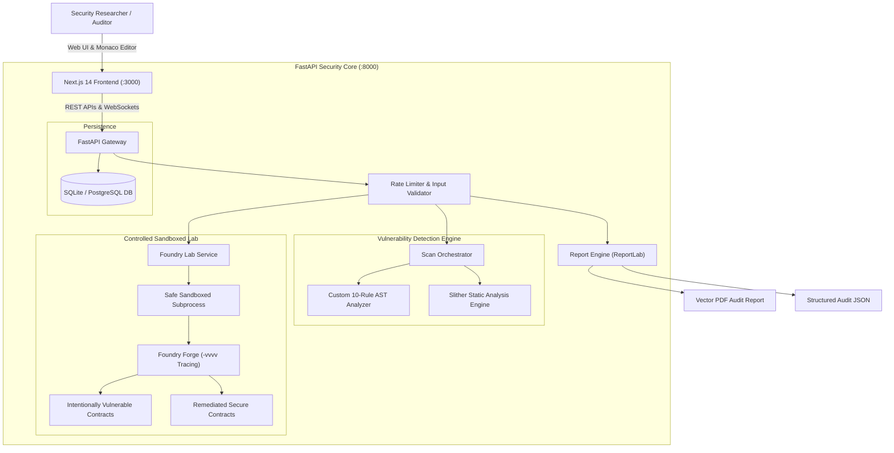

# 🛡️ Web3 Sentinel

> **Production-Quality Ethereum Smart Contract Security Analysis & Controlled Exploitation Platform**

[](contracts/test/)
[](backend/tests/)
[](frontend/)
[](https://github.com/crytic/slither)
[](LICENSE)

---

## 1. Executive Overview

**Web3 Sentinel** is an end-to-end smart contract security research and audit platform. It bridges the gap between static analysis and dynamic proof-of-concept exploit verification by enabling developers and security auditors to:

1. **Scan Solidity Source Code** using Slither and a dedicated 10-rule custom AST heuristic detection engine.
2. **Classify Security Weaknesses** with precision (Critical, High, Medium, Low, Informational) and distinct confidence levels (*Confirmed*, *Potential*, *Informational*).
3. **Execute Controlled Proof-of-Concept Exploits** in an isolated local Foundry sandbox, observing transaction execution depth, balance drains, and raw `-vvvv` execution call traces.
4. **Compare Vulnerable vs. Patched Contracts** with interactive side-by-side diffs and architectural defensive patterns (CEI, Pull-over-Push, ReentrancyGuard, Ownable2Step).
5. **Generate Professional Security Audit Reports** in vector PDF and machine-readable JSON formats suitable for client audits and portfolio presentations.

---

## 2. Architecture Diagram



---

## 3. Technology Stack

- **Smart Contracts**: Solidity (`^0.8.20`), Foundry (`forge`, `anvil`, `cast`), OpenZeppelin Contracts (`v5.x`).
- **Security Analysis**: Slither Analyzer (`v0.11.6`), Custom Python AST & heuristic rules.
- **Backend API**: Python 3.11+, FastAPI, Pydantic v2, SQLAlchemy, ReportLab, Pytest, Uvicorn.
- **Frontend Dashboard**: Next.js 14 (App Router), React 18, TypeScript, Tailwind CSS, Monaco Editor (`@monaco-editor/react`), Recharts, Lucide Icons.
- **DevOps & Testing**: Docker, Docker Compose, GitHub Actions CI/CD.

---

## 4. Vulnerability Detection Engine (10 Categories)

Web3 Sentinel implements rule-based and static dataflow checks for 10 core Ethereum smart contract vulnerabilities:

| # | Vulnerability Class | SWC / Standard | Severity | Mechanics Detected |
|---|---|---|---|---|
| 1 | **Reentrancy** | SWC-107 | **Critical** | External calls (`.call{value:}`) preceding state variable subtraction (CEI violation) |
| 2 | **Improper Access Control** | SWC-105 / 106 | **Critical** | Sensitive administrative functions (`setOwner`, `withdrawAll`, `kill`) missing auth modifiers |
| 3 | **Unchecked Low-Level Calls** | SWC-104 | **High** | Discarded boolean returns on `.call()`, `.send()`, or `.delegatecall()` |
| 4 | **tx.origin Authentication** | SWC-115 | **High** | Phishing vector where `tx.origin == owner` is used instead of `msg.sender` |
| 5 | **Oracle Manipulation** | DeFi Attack | **Critical** | Instantaneous spot reserve calculation without TWAP or Chainlink feed validation |
| 6 | **Integer Underflow/Overflow** | SWC-101 | **High** | Legacy pragmas (`<0.8.0`) without SafeMath or unsafe `unchecked { ... }` decrements |
| 7 | **Dangerous Delegatecall** | SWC-112 | **Critical** | User-controlled delegatecall targets causing state slot collisions |
| 8 | **Unprotected Self-Destruct** | SWC-106 | **Critical** | Public `selfdestruct()` permitting arbitrary ether confiscation (deprecated in EIP-6780) |
| 9 | **Unverified Flash Loan Callbacks** | DeFi Attack | **High** | Flash loan callback without initiator and pool address verification |
| 10 | **Denial of Service (DoS)** | SWC-113 | **High** | Unbounded loops pushing external transfers where a single reverting receiver stalls the contract |

---

## 5. Controlled Exploitation Lab (Foundry)

All exploit demonstrations operate exclusively on local mock contracts inside Foundry's isolated test environment. Live networks and real funds are never targeted.

### Test Matrix

```bash
cd contracts
forge test -vvv
```

```text
Ran 5 test suites:
[PASS] testExploitReentrancy() (gas: 547534)
  Logs: Bank Balance Before Exploit: 10 ETH -> Bank Balance After Exploit: 0 ETH
[PASS] testPatchedBankPreventsReentrancy() (gas: 441611)

[PASS] testExploitMissingAccessControl() (gas: 110986)
  Logs: Compromised Owner: 0xDEAD -> Vault Balance After Exploit: 0 ETH
[PASS] testPatchedVaultPreventsUnauthorized() (gas: 69328)

[PASS] testExploitUncheckedCallSilentFailure() (gas: 183109)
[PASS] testPatchedAuctionPullPattern() (gas: 209591)

[PASS] testExploitSpotPriceManipulation() (gas: 180780)
  Logs: Manipulated Spot Price: 10 ETH per Token (100x spike)
[PASS] testPatchedLendingRejectsManipulatedOrStaleFeed() (gas: 205891)

[PASS] testExploitTxOriginPhishing() (gas: 90871)
[PASS] testPatchedWalletPreventsPhishing() (gas: 45295)

Suite result: ok. 10 passed; 0 failed; 0 skipped
```

### Trace Inspection Example (Reentrancy)

Running `forge test --match-test testExploitReentrancy -vvvv` outputs the exact multi-frame call tree rendered visually inside the Web3 Sentinel dashboard:

```text
ReentrancyAttacker::attack{value: 1 ETH}()
  ├─ VulnerableBank::deposit{value: 1 ETH}()
  ├─ VulnerableBank::withdraw()
  │   ├─ ReentrancyAttacker::receive{value: 1 ETH}()
  │   │   ├─ VulnerableBank::withdraw()
  │   │   │   ├─ ReentrancyAttacker::receive{value: 1 ETH}()
  │   │   │   │   [...10 recursive frames draining bank from 10 ETH to 0 ETH...]
```

---

## 6. Installation & Quick Start

### Prerequisites
- [Git](https://git-scm.com/)
- [Node.js](https://nodejs.org/) (v18 or higher)
- [Python](https://www.python.org/) (3.11 or higher)
- [Foundry](https://getfoundry.sh/) (`forge`, `anvil`)

### Quick Start (Local Development)

#### 1. Smart Contracts
```bash
cd contracts
forge build
forge test
```

#### 2. Backend API
```bash
cd backend
python -m venv venv
# On Windows:
.\venv\Scripts\activate
# On Linux/macOS:
source venv/bin/activate

pip install -r requirements.txt
pip install slither-analyzer pytest httpx

# Run tests
export PYTHONPATH=. # On Windows: $env:PYTHONPATH="."
pytest backend/tests -v

# Start FastAPI server
uvicorn backend.app.main:app --reload --port 8000
```

#### 3. Frontend Dashboard
```bash
cd frontend
npm install
npm run dev
```

Open [http://localhost:3000](http://localhost:3000) in your browser.

---

### Docker Deployment

To launch the complete platform (Backend API + Next.js Frontend) in unified containers:

```bash
docker-compose up --build
```
- Frontend: `http://localhost:3000`
- Backend API Docs: `http://localhost:8000/docs`

---

## 7. Audit Report Generator

Web3 Sentinel automatically synthesizes scan findings into downloadable deliverables:
- **Vector PDF Report**: Generated using ReportLab with executive summary, severity tables, highlighted code locations, and formal disclaimers.
- **Machine-Readable JSON**: Standardized schema containing audit metadata, findings list, CVSS/severity classification, and remediation steps.

Sample JSON report: [`sample_audit_report.json`](sample_audit_report.json).

---

## 8. Security Engineering & Safeguards

- **Safe Subprocess Confinement**: Allowlist restricted strictly to `forge`, `anvil`, and `slither`. Command injection prevented by direct array execution (`shell=False`).
- **File Validation**: Strict 500 KB payload ceiling, `.sol` extension enforcement, UTF-8 decoding assertions, and path traversal scrubbing (`sanitize_filename`).
- **Rate Limiting**: Sliding-window rate limiter (60 requests/min per client) protecting backend services against DoS.
- **Transparent Health Scoring**: Security health scores are calculated with documented deduction weights. The platform explicitly highlights that no score guarantees a contract is completely defect-free.

---

## 9. License

This project is licensed under the [MIT License](LICENSE).
